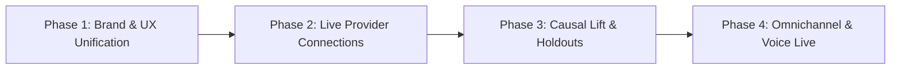

# Architectural Plan: RecoverFlow AI Advanced Roadmap

## Executive Summary
This document establishes the phased implementation plan for advancing **RecoverFlow AI** from a prototype and benchmark laboratory into an enterprise-grade autonomous revenue recovery platform. 

Per owner directive, execution begins with **Phase 1 (Brand & UX Unification)** followed immediately by **Phase 2 (Live Provider Gateway Connections)**.

---

## Phased Roadmap

### Phase 1: Brand & UX System Unification (Immediate Focus)
* **Objective**: Eliminate legacy brand dissonance between the main application (**RecoverFlow AI**) and the benchmark lab (**PayBack AI**).
* **Scope**:
  1. **Benchmark Lab & Navigation Header**: Unify the top bar logo and page headers to `RecoverFlow AI — Benchmark & Evaluation Lab`.
  2. **Guided Self-Playing Proof Tour**: Update copy, badges, and tour highlights in `SelfPlayingTour.tsx` to reference RecoverFlow AI's deterministic bandit algorithms and Merkle ledger.
  3. **Adversarial & Comparative Modals**: Update `BlindBotReplayModal.tsx` ("Blind-Bot vs RecoverFlow AI Replay Arena"), `JudgeModeModal.tsx`, and `CheatSheetModal.tsx`.
  4. **Mobile Failure Trigger**: Re-brand `/trigger` from "PayBack AI" to "RecoverFlow AI Trigger Simulator".
  5. **Design System & LocalStorage**: Align storage keys (e.g. `recoverflow_tour_completed_v1`) and preserve the 3-color palette (`#060c16` canvas, emerald accents, slate typography).

### Phase 2: Live Provider Gateway Connections (Immediate Focus)
* **Objective**: Transition external commerce and gateway connectivity from mock demo isolation to secure, tenant-scoped live/sandbox operation.
* **Scope**:
  1. **Console Integrations Dashboard (`/integrations`)**:
     - Add **Razorpay** (Payment Gateway & Mandates) alongside Shopify, WhatsApp, and Resend/Email.
     - Display live connection state, active webhook URLs, and required cryptographic signing secrets.
     - Add tenant-scoped credential validation API (`/api/console/integrations/verify`) that tests provider connectivity without returning secret values.
  2. **Proxy & Routing Architecture (`apps/web/src/proxy.ts`)**:
     - Refactor the hardcoded HTTP 503 gateway block in `LIVE`/`SANDBOX` modes.
     - Permit authenticated incoming webhooks (`/api/webhooks/razorpay`, `/api/webhooks/shopify/*`, `/api/webhooks/whatsapp`) when valid cryptographic HMAC signatures and merchant tenant mappings are present.
     - Maintain strict fail-closed protection: reject untrusted or unsigned payloads.
  3. **Merchant Credentials Data Model**:
     - Verify Prisma schema support for merchant Razorpay Key ID and Key Secret (encrypted at rest).
     - Wire `PrismaDatabase` and `MemoryDatabase` methods for secure credential retrieval.

### Phase 3: True Causal Lift & Synthetic Holdout Groups (Upcoming)
* **Objective**: Statistically prove incrementality to enterprise merchants.
* **Scope**: Implement a 10% randomized control holdout group in Thompson Sampling allocation. Compute Brier scores and counterfactual yield curves comparing treated vs. untreated cohorts.

### Phase 4: Omnichannel WhatsApp Pay & Gemini Live Voice (Upcoming)
* **Objective**: Next-generation checkout recovery via interactive buttons, native UPI intent links, and real-time WebRTC voice concierge follow-up for high-LTV carts.

---

## 3 Technical Approaches & Trade-Off Analysis

| Approach | Description | Pros | Cons | Recommendation |
| :--- | :--- | :--- | :--- | :--- |
| **Option A: In-Place Consolidation (Recommended)** | Re-brand lab components directly to RecoverFlow AI while preserving "PayBack Engine" as the internal algorithm name; upgrade `proxy.ts` and `/integrations` directly in `apps/web`. | Clean, zero breaking changes to existing test suites, maintains full benchmark credibility, single codebase. | Requires careful selector updates across e2e tests. | **Selected** |
| **Option B: Subdomain Split** | Host Benchmark Lab on `lab.recoverflow.ai` and Console on `app.recoverflow.ai`. | Clean domain separation between developer evaluation and commercial merchant operations. | Extra DNS overhead, cross-origin cookie complexity, increased infrastructure costs. | Deferred to later multi-region launch. |
| **Option C: Mock-Only Gateway Stubs** | Keep external providers permanently mocked with client-side toggles. | Zero security risk, zero external credentials needed. | Fails enterprise pre-launch readiness; cannot connect real Shopify or Razorpay webhooks. | Rejected. |

---

## Pre-Mortem & Failure Mitigations

1. **Risk: Playwright Test Regressions on Re-branding**
   - *Mitigation*: Run unit tests and Playwright suites locally after updating selectors, using regex-based matching where applicable (`/RecoverFlow|Benchmark/i`).
2. **Risk: Webhook Security Vulnerability / Replay in Live Mode**
   - *Mitigation*: Ensure all webhook endpoints verify HMAC signatures *before* processing any state change, and check idempotency keys at the database level.
3. **Risk: Secret Exposure on Console Integrations Page**
   - *Mitigation*: Never send secret keys to the browser; return only boolean `configured: true/false`, masked identifier prefixes (`rzp_live_****`), and status badges.

---

## File Change Checklist (Phases 1 & 2)

- [ ] `apps/web/src/components/Header.tsx` (Unify logo & navigation branding)
- [ ] `apps/web/src/components/BenchmarkLab.tsx` (Update lab title & metrics headers)
- [ ] `apps/web/src/components/SelfPlayingTour.tsx` (Update tour highlights & branding)
- [ ] `apps/web/src/components/BlindBotReplayModal.tsx` (Update comparative modal title & copy)
- [ ] `apps/web/src/app/trigger/page.tsx` (Update mobile failure trigger branding)
- [ ] `apps/web/src/lib/server/console.ts` (Include Razorpay in integration list)
- [ ] `apps/web/src/components/console/WorkspaceSections.tsx` (Enhance `/integrations` card layout)
- [ ] `apps/web/src/proxy.ts` (Tenant-scoped ungating for valid webhook signatures in durable modes)
- [ ] `tests/unit/` & `tests/e2e/` (Update any affected test assertions)

---

## Verification Plan

1. `npm run type-check`: 0 TypeScript errors.
2. `npm run test:unit`: 93+ test files, 601+ unit tests pass.
3. `npx playwright test`: preLaunchAudit, accessibility, and console journey tests pass.
4. Visual QA: Verify `/demo?tour=1`, `/integrations`, and landing page render cleanly without console warnings.
