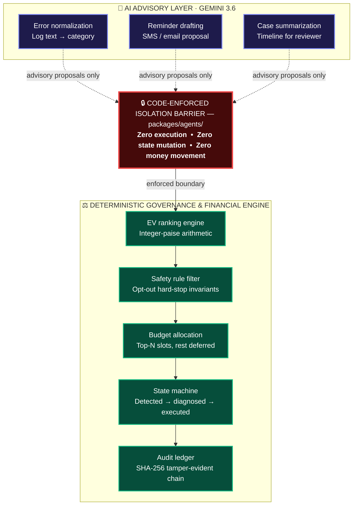

# PayBack AI — Strict AI vs Non-AI Responsibility Boundary

> **Submission Document**: Razorpay AI Buildathon · Track 3: AI Revenue Recovery  
> **Live Web Application**: [https://recoverflow-ai-kohl.vercel.app](https://recoverflow-ai-kohl.vercel.app)  
> **Repository**: [https://github.com/skmdshariff143-ai/recoverflow-ai](https://github.com/skmdshariff143-ai/recoverflow-ai)

---

## 1. Architectural Overview & Code-Enforced Isolation

Google Gemini 3.6 Flash operates strictly as an **advisory-only copilot** with **zero execution rights, zero state-mutation privileges, and zero money-movement authority**. All financial arithmetic, safety rule filters, budget allocations, multi-cycle state machine transitions, and cryptographic audit hashing are executed deterministically by pure TypeScript modules in [`packages/core/src/`](../packages/core/src/).

---

## 2. Responsibility Boundary Matrix

| Capability | Engine Mechanism | Responsible Layer | Code Location | AI Involvement |
|---|---|---|---|---|
| **Probability & EV Math** | Closed-form logistic logit & integer paise math | Deterministic Financial Core | `packages/core/src/financial.ts` | **NONE** |
| **Eligibility & Opt-Outs** | Hard boolean predicate check | Deterministic Safety Filter | `packages/core/src/safetyFilter.ts` | **NONE** |
| **Budget & Capacity Ranking** | EV sorting and capacity capping | Deterministic Prioritization | `packages/core/src/rankAndAllocate.ts` | **NONE** |
| **State Machine Transitions** | Strict finite state transition matrix | Deterministic State Engine | `packages/core/src/stateMachine.ts` | **NONE** |
| **Transaction Execution** | Adapter interface + idempotency store | Execution Boundary | `packages/core/src/adapters/` | **NONE** |
| **Error Log Categorization** | LLM classification with heuristic fallback | Bounded Gemini Copilot | `packages/agents/src/` | **ADVISORY ONLY** |
| **Message Drafting** | Policy-constrained template drafting | Bounded Gemini Copilot | `packages/agents/src/` | **ADVISORY ONLY** |
| **Audit Ledger Hashing** | SHA-256 cryptographic chain | Cryptographic Ledger Engine | `packages/core/src/hashChainLedger.ts` | **NONE** |

---

## 3. High-Value Approval Gate Governance & Thresholds

The platform enforces three distinct, non-overlapping approval thresholds across simulation and production:
1. **₹10,000 Policy Threshold**: Any invoice exceeding ₹10,000 (1,000,000 paise) is classified as `high_value` and halted in `APPROVAL_REQUIRED`. No AI or autonomous actor can bypass this check.
2. **₹5,000 EV Simulation Threshold**: In offline evaluation benchmarks (`simulateAutoApproval: true` in `DEMO` or `TEST` mode), high-value invoices with expected recovery value $\ge ₹5,000$ (500,000 paise) can be conditionally auto-approved to assess autonomous theoretical limits. In `SANDBOX` and `LIVE` runtime modes, the code fails closed to manual review and ignores auto-approval flags.
3. **Two-Reviewer Operator Console Requirement**: Live operator console approval for high-value invoices requires a two-reviewer (maker-checker) sign-off with mandatory audit rationales committed to the cryptographic ledger.
